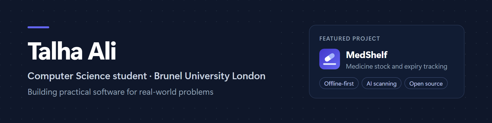

## About me

I'm a Computer Science student at Brunel University London. I build software that solves real operational problems, with a focus on tools that small organisations can run without an IT department: they work in the browser, keep working offline and keep data on the device. Where AI helps, I use it with a person checking the result before anything is saved.

I'm open to software engineering internships and placements.

## Featured project

### [MedShelf](https://github.com/talhaali-tech-engineer/MedShelf)

Offline-first medicine stock and expiry control for small pharmacies and clinic dispensaries.

- Batch-level stock with first-expiry-first-out issuing, expiry alerts and reorder advice
- Shows which batches are likely to expire before they are used, and what they are worth, while there is still time to act
- Optional AI invoice scanning (OpenAI or Claude); nothing is saved until staff have checked every line
- No build step and no dependencies; tested with GitHub Actions and deployed on GitHub Pages

[**Live app**](https://talhaali-tech-engineer.github.io/MedShelf/) &nbsp;·&nbsp; [**Demo video (1:53)**](https://talhaali-tech-engineer.github.io/MedShelf/docs/medshelf-demo.mp4) &nbsp;·&nbsp; [Source code](https://github.com/talhaali-tech-engineer/MedShelf)

## Skills

- **Languages:** JavaScript, Python, Java
- **Web:** HTML, CSS, React, progressive web apps (service workers, IndexedDB)
- **AI:** OpenAI and Anthropic APIs, structured outputs, extracting data from documents and images
- **Tools:** Git, GitHub Actions, GitHub Pages, Node.js

## Contact

[LinkedIn](https://www.linkedin.com/in/talha-ali-71a484410) &nbsp;·&nbsp; [GitHub](https://github.com/talhaali-tech-engineer)
